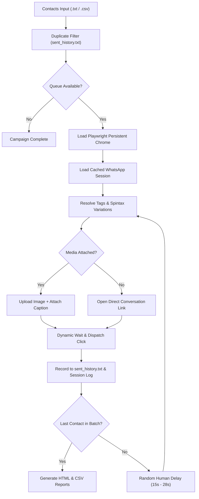

# 🚀 WhatsApp Safe Outreach Automation Engine (Pro)

[](https://www.python.org/)
[](https://playwright.dev/)
[](https://github.com/TomSchimansky/CustomTkinter)
[](https://opensource.org/licenses/MIT)
[](#-anti-ban-engineering)

A resilient, open-source automated outreach engine for **WhatsApp Web**, engineered with **Playwright**, a **modern dark-mode Desktop GUI**, **Spintax dynamic message variation**, **CSV personalization**, **optional media attachments**, and **HTML campaign analytics reporting**.

Designed specifically for online businesses, agencies, and solo entrepreneurs who need reliable, free, and safe client communication without paying for overpriced SaaS tools or risking bans from shady Chrome extensions.

---

## 🌟 What Makes This Stand Out

| Feature | Description |
| :--- | :--- |
| **🖥️ Modern Desktop GUI** | Sleek dark-mode desktop app with live progress bars, pause/resume/stop buttons, and real-time activity logs. |
| **🔀 Spintax Variations** | Generate unique message hashes on the fly (`{Hello\|Hi\|Greetings}`) to defeat automated spam fingerprinting. |
| **🏷️ CSV Personalization** | Address clients by name or company from Excel/CSV (`{name}`, `{company}`) for 3x higher response rates. |
| **🖼️ Media Attachments** | Send visual promo flyers/banners along with your tailored captions. |
| **📊 HTML & CSV Analytics** | Automatic export of post-campaign delivery dashboards with KPI cards and delivery timestamps. |
| **🛡️ Algorithmic Pacing** | Natural human jitter (15–28s) and safe batch boundaries (15–20 contacts) to protect account reputation. |
| **🔄 Persistent Session** | Scan the QR code once; session credentials persist across restarts in a private local profile. |

---

## ⚡ Anti-Ban Engineering

Most bulk WhatsApp senders get accounts banned because of two major flaws:
1. **Third-Party Chrome Extensions:** Extensions inject scripts directly into WhatsApp Web's internal JavaScript memory (`window.Store.Chat`), which WhatsApp's anti-bot scanner easily catches.
2. **Velocity & Identical Text Hashes:** Sending bursts of identical copy within seconds alerts WhatsApp's velocity filters.

### 🛡️ How This Engine Protects Your Account:
* **Native Playwright Browser Protocol:** Runs inside an official Google Chrome instance with native trusted DOM events (`isTrusted: true`)—identical to a human clicking.
* **Spintax Hash Neutralization:** Generates slightly different text variations for every contact, preventing hash clustering.
* **Algorithmic Human Jitter:** Enforces randomized pauses (**15 to 28 seconds**) between dispatches to mimic natural reading and typing habits.
* **Safe Session Batching:** Built-in safeguards recommend processing in batches of **15–20 contacts** per session.
* **Duplicate Protection:** Automatically tracks completed dispatches in `sent_history.txt` so leads are never spammed twice.

---

## 🏗️ Architecture & Workflow



---

## 📥 Installation & Setup

### Prerequisites
* **Python 3.9+** installed on your system.
* **Google Chrome** installed.

### 1. Clone the Repository
```bash
git clone https://github.com/your-username/whatsapp-outreach-engine.git
cd whatsapp-outreach-engine
```

### 2. Install Dependencies
You can install dependencies using the 1-click Windows installer or via terminal:

**Windows (1-Click):**
Double-click `install.bat`

**Terminal:**
```bash
pip install -r requirements.txt
```

---

## 🚀 How to Use

### Option A: Modern Desktop GUI (Recommended)
Double-click **`run_gui.bat`** (or run `python app_gui.py`).
1. Select your contacts file (`.txt` or `.csv`).
2. Write or adjust your message template using `{name}` and `{Option 1|Option 2}` Spintax.
3. (Optional) Choose a promo flyer image.
4. Click **▶ Start Campaign**!

### Option B: Command-Line Interface (CLI)
Double-click **`run_auto_outreach.bat`** (or run `python auto_outreach.py`).
Follow the interactive terminal prompts to choose Test Mode (`1`) or Safe Batch Mode (`2`).

---

## 📝 Spintax & CSV Personalization Guide

### 1. Spintax Syntax
Wrap synonyms in curly brackets separated by vertical pipes:
```text
{Hello|Hi|Greetings} {name}! 👋

We are {excited|pleased} to share our {special|exclusive} offer with you today.
```
* Contact 1 receives: *"Hello Tanvir! We are excited to share our special offer..."*
* Contact 2 receives: *"Hi Rafiq! We are pleased to share our exclusive offer..."*

### 2. CSV Columns
You can load a `contacts.csv` with custom columns:
```csv
Phone,Name,Company,Notes
+8801700000001,Tanvir,Alpha Trading,VIP Client
+8801800000002,Rafiq,Apex Logistics,Retail Lead
```
Use `{name}`, `{company}`, or `{phone}` inside your message to personalize automatically!

---

## 📁 Repository Structure

```text
├── app_gui.py              # Modern dark-mode Desktop GUI (CustomTkinter)
├── auto_outreach.py        # Core CLI outreach automation launcher
├── core/
│   ├── __init__.py
│   ├── spintax.py          # Spintax & template variable resolver
│   ├── contact_loader.py   # TXT & CSV parser with phone normalization
│   ├── reports.py          # HTML dashboard & CSV analytics generator
│   └── engine.py           # Thread-safe Playwright background orchestrator
├── contacts.txt            # Sample plain numbers list
├── contacts.sample.csv     # Sample CSV demonstrating {name} & {company}
├── message.txt             # Sample outreach copy with Spintax syntax
├── requirements.txt        # Python dependencies
├── install.bat             # 1-click dependency installer for Windows
├── run_gui.bat             # 1-click Desktop GUI launcher
├── run_auto_outreach.bat   # 1-click CLI launcher
├── .gitignore              # Ignores wa_profile/, local leads, and reports
├── LICENSE                 # MIT Open-Source License
└── README.md               # Project documentation
```

---

## 🔒 Privacy & Security

> [!IMPORTANT]
> **Never commit your `wa_profile/` directory!**  
> The `wa_profile/` directory contains active session cookies and encryption keys for your WhatsApp account. It is pre-configured in `.gitignore` to prevent accidental uploads.

---

## ⚖️ Ethical Use & Disclaimer

This software is developed strictly for educational and legitimate business communications (e.g., reaching opted-in customers, customer support notification dispatches, and transactional updates). 

Please ensure your outreach complies with the [WhatsApp Terms of Service](https://www.whatsapp.com/legal/terms-of-service) and local telecommunication privacy laws. The authors and contributors are not responsible for any misuse, spamming, or account restrictions.

---

## 📄 License

Distributed under the **MIT License**. See `LICENSE` for more information.
