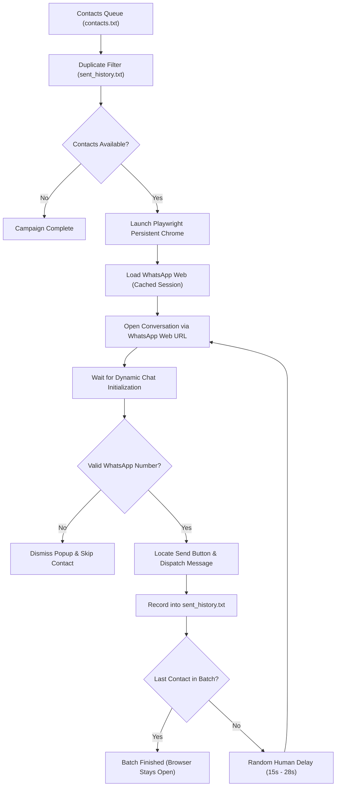

# 🚀 WhatsApp Safe Outreach Automation Engine

[](https://www.python.org/)
[](https://playwright.dev/)
[](https://opensource.org/licenses/MIT)
[](#-why-this-prevents-account-bans)

A lightweight, resilient automated outreach engine for **WhatsApp Web**, engineered with **Playwright**, persistent session caching, and **algorithmic human pacing** to prevent spam flags and account bans.

Designed specifically for online businesses, solo entrepreneurs, and customer service teams who need reliable, free, and safe client communication without paying for overpriced SaaS tools or risking bans from shady Chrome extensions.

---

## ⚡ Why This Prevents Account Bans

Most automated WhatsApp tools get accounts banned because of two major flaws:
1. **Third-Party Chrome Extensions:** Extensions inject custom scripts directly into WhatsApp Web's internal JavaScript memory and DOM (`window.Store.Chat`), which WhatsApp's anti-bot scanner easily catches.
2. **Velocity & Machine Pacing:** Sending bursts of 50+ messages within seconds alerts WhatsApp's heuristics immediately.

### 🛡️ How This Engine Protects Your Account:
* **Real Browser Protocol:** Operates inside a standard Google Chrome instance using native browser protocol events—identical to a human typing and clicking.
* **Algorithmic Human Jitter:** Enforces randomized pauses (**15 to 28 seconds**) between consecutive dispatches to simulate real human typing and reading pacing.
* **Safe Session Batching:** Built-in safeguards recommend processing in batches of **15–20 contacts** per session.
* **Duplicate Protection:** Automatically tracks completed dispatches in `sent_history.txt` so leads are never spammed twice.
* **Zero DOM Tampering:** Does not modify WhatsApp Web's internal code or reverse-engineer private APIs.

---

## 🏗️ Architecture & Workflow



---

## 🌟 Key Features

* **Persistent Browser Context:** Scan the WhatsApp Web QR code once during the first run. Authentication tokens and encryption keys are safely stored in your local `wa_profile/` directory and persist indefinitely.
* **Deterministic Element Selectors:** Uses Playwright's robust locator engine (`button[aria-label="Send"]`, `span[data-icon="send"]`) instead of unreliable screen coordinate or image-matching scripts.
* **Smart Number Normalization:** Automatically handles international formats as well as localized formats (e.g., standardizing `017xxxxxxxx` to `+88017xxxxxxxx`).
* **Unregistered Number Recovery:** If a customer's phone number is not registered on WhatsApp, the engine automatically detects the error modal, dismisses it, and proceeds to the next lead without hanging.
* **Interactive CLI & Test Mode:** Single-contact Test Run mode (`[1]`) allows you to test your message with 1 lead and verify the output before initiating a broader batch.
* **1-Click Launchers:** Includes double-clickable Windows `.bat` launchers for easy daily use.

---

## 📥 Installation & Setup

### Prerequisites
* **Python 3.9+** installed on your system.
* **Google Chrome** installed.

### 1. Clone the Repository
```bash
git clone https://github.com/your-username/whatsapp-outreach-engine.git
cd whatsapp-outreach-engine
```

### 2. Install Dependencies
You can install dependencies using the 1-click Windows installer or via terminal:

**Windows (1-Click):**
Double-click `install.bat`

**Terminal:**
```bash
pip install -r requirements.txt
```

---

## 🚀 How to Use

### Step 1: Configure Your Message
Open `message.txt` and customize your business offer or outreach pitch:
```text
Hello! 👋

We are excited to share an exclusive update regarding our services...
```

### Step 2: Add Target Contacts
Open `contacts.txt` and paste your customer phone numbers (one per line):
```text
+8801700000001
+8801700000002
01800000003
```

### Step 3: Launch Outreach
* **Windows:** Double-click `run_auto_outreach.bat`
* **Command Line:** Run:
```bash
python auto_outreach.py
```

### Step 4: First-Time Login (One-Time Setup)
1. On the very first run, a Google Chrome window will open with WhatsApp Web.
2. Open your WhatsApp mobile app: **Settings → Linked Devices → Link a Device**, and scan the QR code.
3. Once logged in, your session is permanently cached in `wa_profile/`—you will **never** need to scan the QR code again!

---

## 📁 Repository Structure

```text
├── auto_outreach.py          # Core Playwright automation engine
├── contacts.txt              # Target client phone numbers (one per line)
├── message.txt               # Promotional outreach message template
├── requirements.txt          # Python dependencies (playwright)
├── install.bat               # 1-click dependency installer for Windows
├── run_auto_outreach.bat     # 1-click execution launcher for Windows
├── .gitignore                # Protects session keys, local data, and logs
├── LICENSE                   # MIT Open-Source License
└── README.md                 # Project documentation
```

---

## 🔒 Privacy & Security

> [!IMPORTANT]
> **Never commit your `wa_profile/` directory!**  
> The `wa_profile/` directory contains active session cookies and encryption keys for your WhatsApp account. It is pre-configured in `.gitignore` to prevent accidental uploads.

---

## ⚖️ Ethical Use & Disclaimer

This software is developed strictly for educational and legitimate business communications (e.g., reaching opted-in customers, customer support notification dispatches, and transactional updates). 

Please ensure your outreach complies with the [WhatsApp Terms of Service](https://www.whatsapp.com/legal/terms-of-service) and local telecommunication privacy laws. The authors and contributors are not responsible for any misuse, spamming, or account restrictions.

---

## 📄 License

Distributed under the **MIT License**. See `LICENSE` for more information.
