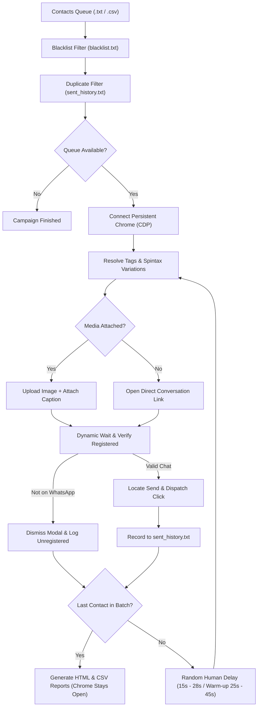

# 🚀 WhatsApp Safe Outreach Automation Engine (Pro)

[](https://github.com/sadmandied/whatsapp-outreach-engine/actions)
[](https://www.python.org/)
[](https://playwright.dev/)
[](https://github.com/TomSchimansky/CustomTkinter)
[](https://opensource.org/licenses/MIT)
[](#-anti-ban-engineering)

A resilient, open-source automated outreach engine for **WhatsApp Web**, engineered with **Playwright**, a **modern dark-mode Desktop GUI (Linear/GitHub aesthetic)**, **Spintax dynamic message variation**, **CSV personalization**, **optional media attachments**, **HTML campaign analytics reporting**, **template preset manager**, **blacklist protection**, and **multi-account profile switching**.

Designed specifically for online businesses, agencies, and entrepreneurs who need reliable, free, and safe client communication without paying for overpriced SaaS subscriptions or risking bans from sketchy Chrome extensions.

---

## 🌟 Key Capabilities

| Feature | Description |
| :--- | :--- |
| **🖥️ Modern Desktop GUI** | Sleek dark-mode desktop app with responsive resizing, live progress bar, pause/resume/cancel controls, and real-time activity stream. |
| **🔀 Spintax Variations** | Generate unique message hashes on the fly (`{Hello\|Hi\|Greetings}`) to defeat automated spam fingerprinting. |
| **🏷️ CSV Personalization** | Address clients by name or company from Excel/CSV (`{name}`, `{company}`) for 3x higher response rates. |
| **📂 Template Presets** | Built-in message library with 1-click dropdown switching and "Save As" preset management (`templates.json`). |
| **🚫 Blacklist Protection** | Never contact opted-out leads, friends, or staff—automatically excluded via `blacklist.txt`. |
| **🧹 1-Click Lead Cleaner** | Auto-strips duplicates, invalid formats, previously contacted numbers, and confirmed non-WhatsApp numbers into a pure clean export. |
| **👥 Multi-Account Switching** | Seamlessly manage multiple WhatsApp SIM cards/accounts with isolated browser session profiles (`wa_profile/`, `wa_profile_2/`). |
| **⏰ Hands-Free Scheduler** | Set execution times (e.g., `14:30`) or countdown delays (`+45 mins`) with live countdown telemetry. |
| **🛡️ Account Warm-Up Mode** | Enforces gentle batch limits and relaxed delay jitter (25s–45s) for brand-new SIMs or fresh numbers. |
| **🖼️ Media Attachments** | Send visual promo flyers/banners along with your tailored captions. |
| **📊 HTML & CSV Analytics** | Automatic export of post-campaign delivery dashboards with search, status filters, and CSV exports. |
| **🔄 Persistent Chrome** | Chrome runs as an independent detached process via CDP—stays open on your screen even when you close the app. |

---

## ⚡ Anti-Ban Engineering

Most bulk WhatsApp senders get accounts banned because of two major flaws:
1. **Third-Party Chrome Extensions:** Extensions inject scripts directly into WhatsApp Web's internal JavaScript memory (`window.Store.Chat`), which WhatsApp's anti-bot scanner easily catches.
2. **Velocity & Identical Text Hashes:** Sending bursts of identical copy within seconds alerts WhatsApp's velocity filters.

### 🛡️ How This Engine Protects Your Account:
* **Native Playwright Browser Protocol:** Runs inside an official Google Chrome instance with native trusted DOM events (`isTrusted: true`)—identical to a human clicking.
* **Spintax Hash Neutralization:** Generates slightly different text variations for every contact, preventing hash clustering.
* **Algorithmic Human Jitter:** Enforces randomized pauses (**15 to 28 seconds** in normal mode, **25 to 45 seconds** in warm-up mode) to mimic natural human pacing.
* **Safe Session Batching:** Built-in safeguards recommend processing in batches of **15–20 contacts** per session.
* **Unregistered Number Auto-Dismissal:** Detects non-WhatsApp numbers, auto-clicks "OK", logs the lead, and moves to the next contact without getting stuck.
* **Duplicate & Blacklist Protection:** Automatically excludes previous recipients in `sent_history.txt` and protected contacts in `blacklist.txt`.

---

## 🏗️ Architecture & Workflow



---

## 📥 Installation & Setup

### Prerequisites
* **Python 3.9+** installed on your system.
* **Google Chrome** installed.

### 1. Clone the Repository
```bash
git clone https://github.com/sadmandied/whatsapp-outreach-engine.git
cd whatsapp-outreach-engine
```

### 2. 1-Click Install (Windows)
Double-click **`install.bat`** (or run `pip install -r requirements.txt`).

---

## 🚀 How to Use

### Option A: Modern Desktop GUI (Recommended)
Double-click **`WhatsApp Outreach Engine.lnk`** or **`run_gui.bat`** (or run `python app_gui.py`).
*(To create the desktop shortcut with the custom green icon anytime, double-click `create_shortcut.bat`).*
1. **Choose Profile:** Select your WhatsApp account profile from the top bar.
2. **Select Contacts:** Choose your `.txt` or `.csv` file. Click **Clean & Export List** anytime to purge bad numbers.
3. **Pick a Message Preset:** Choose from pre-saved pitches (VIP Bonus, Follow-up, Re-engagement) or write custom Spintax copy.
4. **(Optional) Attach Flyer:** Select a promo poster or banner.
5. **Start or Schedule:** Click **▶ Start Queue**, **⏰ Schedule**, or **🧪 Test (1 Lead)**!

### Option B: Command-Line Interface (CLI)
Double-click **`run_auto_outreach.bat`** (or run `python auto_outreach.py`).
```bash
# Run with custom profile and warm-up mode
python auto_outreach.py --profile Account2 --warmup --batch 10

# Clean your contacts file
python auto_outreach.py --clean
```

---

## 📝 Spintax & CSV Personalization Guide

### 1. Spintax Syntax
Wrap synonyms in curly brackets separated by vertical pipes:
```text
{Hello|Hi|Greetings} {name}! 👋

We are {excited|pleased} to share our {special|exclusive} offer with you today.
```
* Contact 1 receives: *"Hello Tanvir! We are excited to share our special offer..."*
* Contact 2 receives: *"Hi Rafiq! We are pleased to share our exclusive offer..."*

### 2. CSV Columns
Load any `contacts.csv` with standard headers:
```csv
Phone,Name,Company,Notes
+8801700000001,Tanvir,Alpha Trading,VIP Client
+8801800000002,Rafiq,Apex Logistics,Retail Lead
```
Use `{name}`, `{company}`, or `{phone}` inside your message to personalize automatically!

---

## 📁 Repository Structure

```text
├── app_gui.py              # Modern dark-mode Desktop GUI (CustomTkinter)
├── auto_outreach.py        # Core CLI outreach automation launcher
├── assets/
│   ├── icon.ico            # Multi-resolution Windows app icon (16x16 to 256x256)
│   └── icon.png            # High-resolution application brand emblem
├── core/
│   ├── __init__.py
│   ├── spintax.py          # Spintax & template variable resolver
│   ├── contact_loader.py   # TXT & CSV parser, blacklist, and lead cleaner
│   ├── templates.py        # Template preset library manager (templates.json)
│   ├── scheduler.py        # Background timed campaign scheduler
│   ├── reports.py          # HTML analytics dashboard & CSV log generator
│   └── engine.py           # Thread-safe Playwright persistent CDP orchestrator
├── contacts.txt            # Sample plain numbers list
├── contacts.sample.csv     # Sample CSV demonstrating {name} & {company}
├── blacklist.sample.txt    # Sample blacklist exclusion file
├── message.txt             # Sample outreach copy with Spintax syntax
├── templates.json          # Default message presets (VIP, Follow-up, etc.)
├── requirements.txt        # Python dependencies
├── install.bat             # 1-click dependency installer for Windows
├── build_exe.bat           # 1-click standalone executable builder (PyInstaller)
├── create_shortcut.bat     # 1-click desktop & project shortcut generator
├── create_shortcut.ps1     # PowerShell script creating .lnk with custom icon
├── run_gui.bat             # 1-click Desktop GUI launcher
├── run_auto_outreach.bat   # 1-click CLI launcher
├── .gitignore              # Strictly protects session keys, reports, and local data
├── LICENSE                 # MIT Open-Source License
└── README.md               # Project documentation
```

---

## 🔒 Privacy & Security

> [!IMPORTANT]
> **Your private data never touches Git!**  
> All sensitive files are pre-configured in `.gitignore`:
> * `wa_profile*/` (Active browser session tokens & encryption keys)
> * `*.local.txt` (Your real customer contacts, copy, and blacklist)
> * `sent_history.txt` (Historical recipient log)
> * `reports/` (Generated delivery analytics)

---

## 📄 License

Distributed under the **MIT License**. See `LICENSE` for more information.
